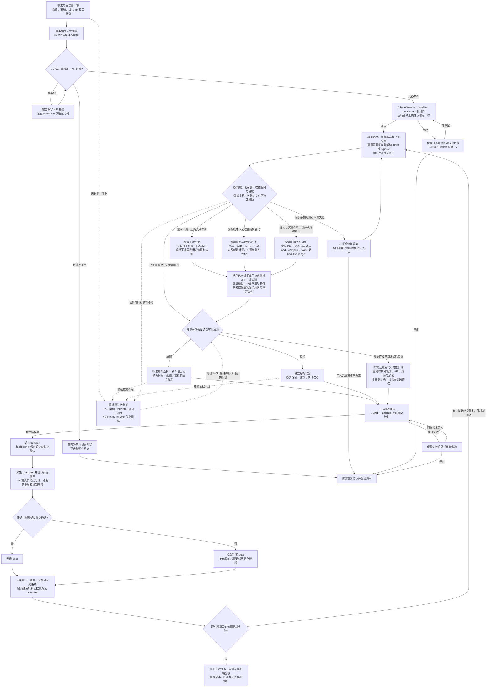

# HCU 算子开发与优化 Skills

本工程的 Hygon 扩展包含三个可安装的 Skill：从参考实现建立正确基线、优化 HIP/CK Tile kernel、调查和优化 Triton/Inductor kernel。以当前工程和目标环境为依据，需要参考代码案例或补充领域资料时可查询 HCU-Knowledge，也可通过 NVIDIA KernelWiki 寻找可迁移的优化思路，代码和实验在实际 HCU 目标环境验证。

## 组织

```text
skills/
  cuda-kernel-optimizer/          # NVIDIA 上游流程；独立保留
  hygon-hip-baseline-generator/   # AST 调查、保守 FP32 脚手架、reference adapter
  hygon-hip-kernel-optimizer/     # 主优化循环、实验门禁、profiling、策略与共同契约
  hygon-triton-kernel-optimizer/  # Inductor 捕获、原始布局复现、Triton 调查
    scripts/ references/ agents/
tests/test_hygon_workflows.py     # CPU 上的语义与流程回归，不冒充 HCU 测试
tools/install_hygon_skills.py    # 备份、安装、文件哈希核验
hygon_tmp/                      # 不提交的采集、缓存、安装备份
```

核心规范是 [HCU 工作契约](skills/hygon-hip-kernel-optimizer/references/hcu-workflow-contract.md)，程序产物见 [实验接口](skills/hygon-hip-kernel-optimizer/references/experiment-artifacts.md)。每个 Skill 的 SKILL.md 是给 Agent 的入口。

DCU/HCU 同义，旧字段与文件名保留。[指令与数据通路指南](skills/hygon-hip-kernel-optimizer/references/hcu-isa-guide.md) 记录孔明至月英的目标名称，逐项区分 MLS、DS/MMAC、低精度 scale、WDRA、barrier 和 TLS 的适用范围，并列出原件出处与待实测边界。

性能分析分别使用 [XProf/XCompute 指南](skills/hygon-hip-kernel-optimizer/references/xprof-xcompute-guide.md) 和 [hipprof 指南](skills/hygon-hip-kernel-optimizer/references/hipprof-guide.md)，命令、输出格式、指标定义与查看器按各自版本核对。

[性能上限与融合指南](skills/hygon-hip-kernel-optimizer/references/performance-limits-and-fusion.md) 共用于 HIP/Triton：从必要工作、接口交接到实际执行，按疑点评估资源与融合全成本，再用实测修正；简单热点保持粗估即可。需要时可复用外部 KRA 的时间线、资源和数据流分析，不增加强制依赖、固定阈值或逐轮全量建模步骤。

[汇编流水与编译后优化](skills/hygon-hip-kernel-optimizer/references/assembly-guided-optimization.md) 提炼 AsmEvo 的热点窗口、对象恢复、差分验证与候选组合方法。可用实际 ISA 指导源码调优，也可按需要直接重建汇编/代码对象；保留 HCU 的目标查证、原 oracle 与完整工程验证。当前脚本不包含 AsmEvo 自动二进制改写系统。

## 工作原理

1. 用户需求与当前代码形成精度/布局/版本/性能契约。
2. 优先查看当前源码、测试、文档和目标工具链；准备新写/融合实现或迭代缺少依据时，主动按需用 `hcu-knowledge-search` 查 HCU 案例，本地缺答案继续搜线上 PR/MR，追描述、review、固定源码及调用/测试。可用 `KernelWiki` 借鉴 NVIDIA 的算法、布局、调度和流水思路，逐项核对 HCU 前提；已有证据足够则直接推进。
3. 保留独立 oracle，验证 baseline，多规模、多 seed、tail 和真实数据分布列入矩阵。成熟专家参考可继承已验证机制，生成基线主要承担正确性职责；两者都不冻结候选架构。
4. 先定位热点与瓶颈假设，按算子难度、复杂度、收益空间和当前进度选择上限评估、融合分析、汇编流水分析中的相关项；已有证据充分则直接实验。分析结果决定局部调参、结构重写或汇编实现，再做串行基准/回归。best 与探索分支分开，暂时更慢但有依据的正确结构可继续研究。筛选后，对当前 best 与候选做四轮独立交替对照；逐轮收益和每例回退条件均通过才晋级。固定阈值与四轮一致性不等于统计置信区间。
5. 遇到 kernel 优化瓶颈时必须使用性能分析工具，优先 XProf/XCompute，也可选适用的 hipprof/DTK 工具；据采集结果决定下一项修改，保留原件、准确 kernel/dispatch、指标定义。未知计数不转成利用率。
6. 结合源码/ISA/资源/timeline 与正确消融解释收益，缺证据的方法记待验证。编译器生成的流水仍有空间时，可选择源码表达、inline asm 或专用汇编实验，直接改写对象需额外核对 ABI/资源与实际加载。最后回到真实模型/项目做端到端验收。
7. 报告与实验原件保留在当前任务工程，说明适用范围、实际收益和未验证项。保存实测事实、条件、反例及未决路线；后续任务先核对相关经验，减少重复试错。详见 [架构探索与经验复用](skills/hygon-hip-kernel-optimizer/references/architecture-search-and-experience.md)。

### 当前 HIP 优化流程

下图是可维护的 Mermaid 源图，替代旧版仅有 hipprof/Wave64 的 HCU 图片。Triton Skill 使用独立捕获/重放流程，共用契约和分析指南，不自动执行 HIP 编排。



首次深入热点、准备结构变化，或停滞/回退/热点转移时，主动重新选择分析深度；复杂问题可提前分析，简单问题沿用同条件证据。三条分析支路可联动，无固定顺序，也不要求每轮全部执行。触发后暂缓时在现有分析中简记原因和重开条件，不增加未触发分支的跳过表；具体判断见 [按难度与进度选择分析深度](skills/hygon-hip-kernel-optimizer/references/hcu-workflow-contract.md#按难度与进度选择分析深度)。

图中的分析选择、证据解释和工程验收由 Agent 根据原件判断；脚本不自动完成这些决策。上限评估帮助选方向，融合分析决定边界与取舍，汇编流水分析可以回到源码修改，不自动导向二进制改写。`close-iter` 可以记录未验证方法，`finalize` 也可用于失败/中止任务。详细的算子路线、数值政策和恢复操作见 [实验操作指南](skills/hygon-hip-kernel-optimizer/references/optimization-playbook.md)。

结构探索和经验读取由 Agent 按任务组织，现有脚本不自动调度多条架构路线或检索跨任务经验。标准方法清单不能表达新结构时，使用项目实验入口并保留同等正确性、回退及独立确认要求；不能伪造方法 ID 或手改 state 的已确认状态。生成器新增的 `optimization_handoff` 只标记来源和正确性脚手架角色，不表示架构性能已验证；旧产物不要求重生成。

图中的汇编支路也是按需的项目实验，不表示自动编排已支持 HSACO 改写。只有原代码对象时，用冻结原对象与真实 dispatch 建立差分测试，注明仅覆盖已测条件；有独立 reference 时继续保留，不以二进制行为取代数学正确性。

虚线是按需查证，不是每轮必经步骤。参考内容经 [查证与迁移规则](skills/hygon-hip-kernel-optimizer/references/hcu-workflow-contract.md#1-证据来源与按需知识查询) 转化为具体实验；它不能替代基线验证、瓶颈 profiling 或多规模回归。报告只记录实际影响决策的来源、迁移前提和本轮结果。

## 安装

本机管理使用 PATH 中的系统 Python。三个 Hygon Skill 一起安装，基线/Triton 会引用 HIP Skill 的共同规范。

```powershell
cd D:\git\cuda-optimized-skill
python -X utf8 tools/install_hygon_skills.py
```

默认目标为 `$CODEX_HOME/skills`（未设置时是用户目录 `.codex/skills`），可以 `--skills-dir PATH`。先保存旧文件到本仓 `hygon_tmp/skill-backups/TIMESTAMP`，再复制和核对 SHA256。不会修改别的 Skill，也不随安装执行远端代码。当前会话若已经载入旧 Skill，下一任务/新会话再加载新入口。

`hcu-knowledge-search` 和 `KernelWiki` 是可选参考工具，不随这三个 Skill 自动安装；使用时按各自 Skill 的入口与本机配置定位。没有配置知识库也可以使用这三个 Skill。无需安装本工程为 Python 包，不依赖 MCP 或向量检索模型。

### 依赖与环境

- 管理/静态分析：Python 3.10+，Skill 格式检查需要 PyYAML，回归测试需要 pytest 和 PyTorch。缺包按 `python -m pip install PACKAGE` 安装到相同环境。
- HCU 编译运行：目标机器可用的 DTK/HIP、匹配的 HCU PyTorch、hipcc 兼容驱动；CK Tile/Triton 或项目特定库按任务安装。AICC 与 DTK 默认编译器分别固定版本。
- 采集：目标支持的 XProf/XCompute 或 hipprof；ISA工具以实际代码对象/版本为准。工具存在不代表有权限或支持当前 gfx。
- Perfetto 分析是可选依赖；指定已安装 trace_processor_shell 路径，脚本不隐式下载二进制。新工具按本机约定放 D盘工具目录。
- KRA 是可选外部参考/工具：查方法或实现可直接在线读 GitHub 的固定版本文档和源码，不必下载全仓；需要运行或调试时再获取，依赖按该版本 README/pyproject 核对。AsmEvo 本轮只采用论文方法，不是安装依赖；工具支持与 HCU 验证由具体任务确认。
- SSH/容器通过项目既有远端流程。Agent 可本地，实际构建、正确性、性能验证在 HCU 节点；不要求所有 Agent 必须远程运行。

## 怎么用

在 Codex 中直接说明算子、源码/参考文件、输入/精度与远端环境，例如：

- “用 `$hygon-hip-baseline-generator` 把这个 reference 建成 HCU 正确性基线。”
- “用 `$hygon-hip-kernel-optimizer` 优化这个 kernel，覆盖这组 shapes，保持 BF16 数值规则。”
- “用 `$hygon-triton-kernel-optimizer` 找这个模型的 Inductor 热点，核对生成 ISA 和端到端收益。”

详细命令位于各 Skill；通用 HIP harness **只支持简单连续 flat ABI**，半精度/量化/复杂布局等用工程专用 benchmark。优化框架接受 `--benchmark`，但结果必须带真实样本、正确性与源码哈希。`--workloads` 接显式矩阵；不传只能得到单形状结论。

自定义 benchmark 的独立确认还要求输入内容指纹、设备、签名、seed、warmup/repeat 等元数据；旧适配器缺字段时保持待确认，按 [实验接口](skills/hygon-hip-kernel-optimizer/references/experiment-artifacts.md) 补齐。通用 benchmark 用哨兵验证输出写覆盖，并保存每次实际编译的二进制及 SHA；ISA 检查不使用来源不明的相邻 `.so`。

## 检查

```powershell
python -X utf8 -m pytest tests/test_hygon_workflows.py -q
$env:PYTHONPATH = "$PWD/skills/cuda-kernel-optimizer/scripts"
python -X utf8 -m pytest skills/cuda-kernel-optimizer/tests -q
```

这些检查覆盖不可信/缺失实验数据、精度、输入捕获、生成器和流程边界。不能代替真实 HCU 编译、采集、race/越界检测、项目单测和模型性能验收。历史 run 的旧结果也不会因脚本升级自动变成已验证。
